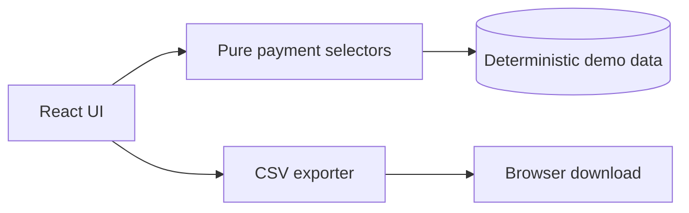

# Accessible Payment Dashboard

A keyboard-first payment analytics dashboard designed around semantic HTML, predictable focus order, visible validation, and screen-reader announcements. It uses deterministic demo data so the UI is fully runnable without external accounts or payment credentials.

Live demo: https://accessible-payment-dashboard.vercel.app

## What it demonstrates

- Search and status filtering over a typed transaction model.
- Summary metrics derived from the visible data slice rather than duplicated state.
- Semantic tables with row headers, table captions, and machine-readable timestamps.
- Status and risk signals that remain understandable without color alone.
- CSV export with an `aria-live` confirmation announcement.
- Responsive layout with a visible skip link and focus styling.

## Architecture



## Structural overview

```text
src/
  App.tsx                 UI composition and interaction state
  domain/payments.ts      payment types, filtering, and summary logic
  styles.css              responsive visual system and focus treatment
tests/
  payments.test.ts        selector and aggregation tests
.github/workflows/ci.yml  lint, test, and production build
```

## Workflow

1. The user searches or chooses a status.
2. `filterPayments` produces a new visible slice; no mutable table state is shared with the UI.
3. `summarize` derives gross, settled, and failure totals from that slice.
4. Export serializes only the currently visible rows and announces completion through a polite live region.

## Design decisions

The dashboard keeps the data layer framework-free so selectors can be tested without a browser. A semantic HTML table was chosen over a grid because the content is tabular and users benefit from native screen-reader navigation. Status is conveyed by text plus color, and all controls retain a visible focus ring.

A real payment provider is deliberately excluded from this demo. Provider integrations would require a tokenization boundary, PCI scope review, webhook verification, and secrets management; pretending to provide those without credentials would make the example misleading.

## Run locally

```bash
npm ci
npm run dev
```

Run verification:

```bash
npm run lint
npm test
npm run build
```

## Accessibility verification

Use keyboard-only navigation, a screen reader, browser zoom at 200%, and a contrast checker. The project targets WCAG 2.2 AA; the included UI avoids relying on hover, color, or pointer-only interactions.
